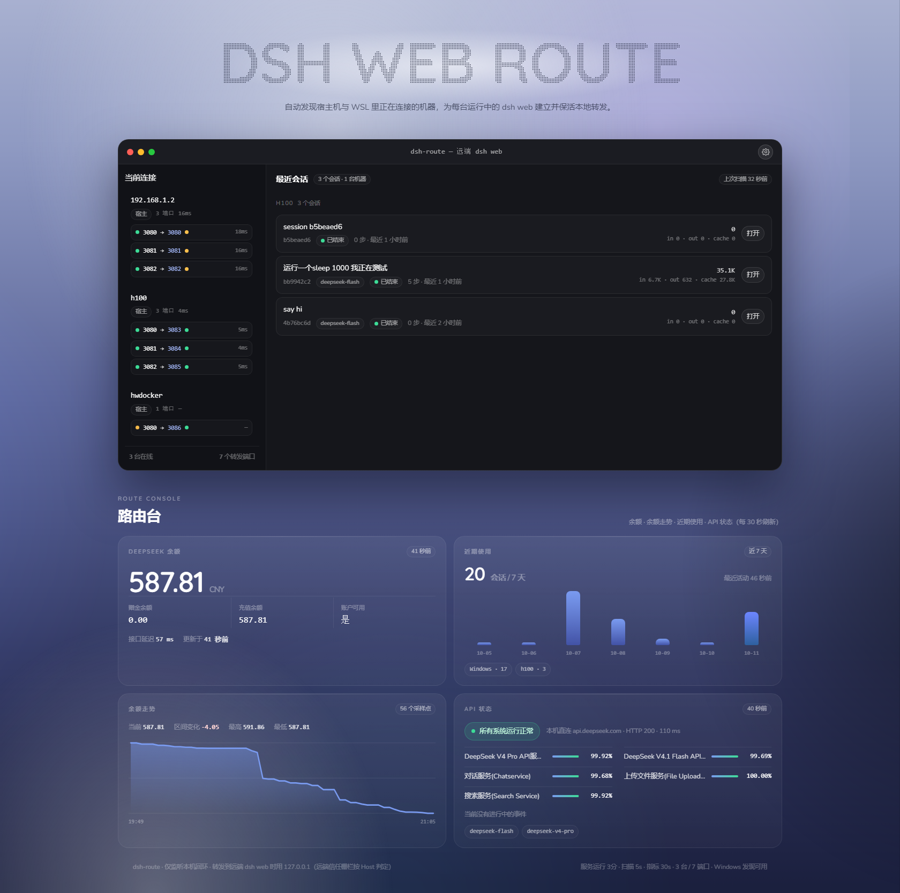

# dsh-route

[](https://github.com/lglglglgy/dsh-route/actions/workflows/ci.yml)
[](https://github.com/lglglglgy/dsh-route/releases/latest)
[](LICENSE)

**在一台机器上，管好你所有的远端 dsh。**

你平时会 `ssh` 到好几台机器，每台上都可能跑着 dsh web。dsh-route 常驻在你本地：
自动发现你**当前 ssh 连着**的机器 → 逐个验证上面的 dsh web 端口 → 为每个可用端口建立并保活一条本地转发
→ 最后给一个控制台，左边是机器和端口，右边是各机最近的会话，下面是 DeepSeek 余额与 API 状态。



## 三步开始

```bash
# 1) 下载发布页里的 .run（或 git clone 后跳过这步）
curl -fsSLO https://github.com/lglglglgy/dsh-route/releases/latest/download/dsh-route-0.1.4.run

# 2) 安装并启动（装在用户目录，不需要 root）
chmod +x dsh-route-0.1.4.run && ./dsh-route-0.1.4.run

# 3) 浏览器打开（装的时候会自动配好 dsh.local 这个别名）
open http://dsh.local:3090/      # 没有别名时用 http://127.0.0.1:3090/
```

装完之后**像平常一样 `ssh` 到你那些机器**就行——面板上会自动出现它们，不用维护任何主机清单。

## 它会做什么

| | |
| --- | --- |
| **自动发现** | 只看你当前 ssh 着的机器（读本机进程），不用写配置、不用同步 ssh config |
| **只转真的 dsh** | 候选端口（默认 3080 / 3081 / 3082）逐个验证，必须返回 dsh 的特征响应才建隧道；别的 HTTP 服务会被标成"非 dsh，未转发" |
| **各自保活** | 一个"机器:端口"一条独立隧道，掉线按 2→30 秒退避重连；本地端口自动分配不冲突 |
| **一站管理** | 一个页面里看全部：端口与延迟、各机最近会话（token 用量 / 运行中 / 等待审批 / 已结束，点"打开"直达）、余额与走势、近 7 天使用、DeepSeek API 状态 |
| **零 root** | 全部装在用户目录，代码 / 配置 / 状态分离，升级只覆盖代码 |

## 访问地址

控制页只监听本机回环，下面几种写法都可以：

| 地址 | 说明 |
| --- | --- |
| `http://dsh.localhost:3090/` | **零授权**：macOS / Linux / WSL 都会把 `*.localhost` 解析到回环，开箱即用（Windows 不解析，那边用下一个） |
| `http://dsh.local:3090/` | 默认别名，安装时自动写 hosts；WSL 里会弹一次 UAC 写 Windows 的 hosts（浏览器在 Windows 侧） |
| `http://localhost:3090/` | 所有系统都能用（同时监听 IPv4 与 IPv6 回环） |
| `http://127.0.0.1:3090/` | 一直都可用；**点进某台机器的 dsh web 时请用这个**（远端信任栅栏按 Host 判定） |

别名没写进 hosts 时（例如 macOS 用户级服务没权限），面板和 `dsh-route status` 会告诉你原因，
并给出上面那个免授权地址。随时可以补写、改名或移除：

```bash
dsh-route host-alias               # 写 /etc/hosts（会问一次密码；macOS 弹图形授权框）
dsh-route host-alias my.dsh        # 换成 my.dsh
dsh-route host-alias --remove      # 移除
dsh-route host-alias --windows     # WSL：写 Windows 的 hosts（弹一次 UAC）
```

## 支持平台

| 平台 | 常驻方式 | 发现方式 |
| --- | --- | --- |
| Linux | `systemd --user`（默认）／`--system` 装成系统服务 | 读 `/proc` 里的 ssh 进程 |
| WSL | 同 Linux | 读 `/proc` +（额外）Windows 侧 `ssh.exe`，宿主机上的目标也能发现 |
| macOS | `launchd` 用户代理（无需 sudo） | `ps` 里的 ssh 进程 |

三种都不依赖特定发行版；没有服务管理器时会退化成后台进程 + `crontab @reboot`。

## 常用命令

```bash
dsh-route                  # 当前连接、转发端口与访问地址
dsh-route open             # 控制台地址
dsh-route url h100         # 某台机器可直接打开的 URL（带 token）
dsh-route key              # 录入 DeepSeek API key（余额面板用，不回显）
dsh-route key-show         # 看当前 key 概况
dsh-route where            # 访问地址、服务类型、配置与路径
dsh-route start | stop | restart | log
dsh-route uninstall        # 卸载（--purge 连配置与历史一起删）
```

## 需要什么

- `python3 ≥ 3.9`、`curl`、`ssh`（后两个系统自带）
- 常驻：`systemd --user` 或 `launchd`；没有也能跑（后台进程 + crontab）
- 想看到会话里的 token 数：能解开远端会话文件即可 —— 远端有 `zstd` 或 **dsh 自带的 node** 就行，
  **本机不需要装 Python 3.14**（本机只作兜底）
- 余额面板需要 DeepSeek API key：`dsh-route key`

## 常见问题

**面板是空的？**
确认你确实 ssh 着目标机——这是唯一的发现口径。`dsh-route status` 会显示发现方式与进程数。

**某台机器显示"非 dsh，未转发"？**
那个端口上有 HTTP 服务但不是 dsh web，按设计不建立隧道。

**会话卡片没有 token 数？**
那台机器上没取到会话文件，或者拿不到 token。远端装了 `zstd`（或 dsh 自带的 node 可用）就能解析。

**余额是空的？**
`dsh-route key` 录入 API key（也可以写 `~/.config/dsh-route/deepseek.key`）。

**macOS 上"API 状态"显示不可达？**
本机到 `status.deepseek.com` 的连接在 TLS 握手阶段被中间设备重置（不是 DeepSeek 故障，面板会降级显示并注明原因）。
可在配置里设 `PROXY=http://127.0.0.1:7890`，或忽略——直连 `api.deepseek.com` 的探测仍会显示。

**服务没自启 / 重启后没了？**
Linux/WSL 建议 `loginctl enable-linger $USER`；或 `./install.sh --system` 装成系统服务。

## 卸载

```bash
dsh-route uninstall            # 停服务、删代码与客户端；保留配置与余额历史
dsh-route uninstall --purge    # 连配置、API key、余额历史一起删
dsh-route uninstall --dry-run  # 只打印会删什么
```

卸载器是安装时写进 PATH 的，**不需要保留发行包**；它读安装清单（`~/.local/share/dsh-route/MANIFEST`）
精确删除，`/etc/hosts` 与 Windows hosts 里由它写入的别名也会一并清掉。

## 更多

- 开发、测试、发布流程与实现细节：[docs/DEVELOPMENT.md](docs/DEVELOPMENT.md)
- 变更记录：[CHANGELOG.md](CHANGELOG.md)
- 许可：[MIT](LICENSE)
